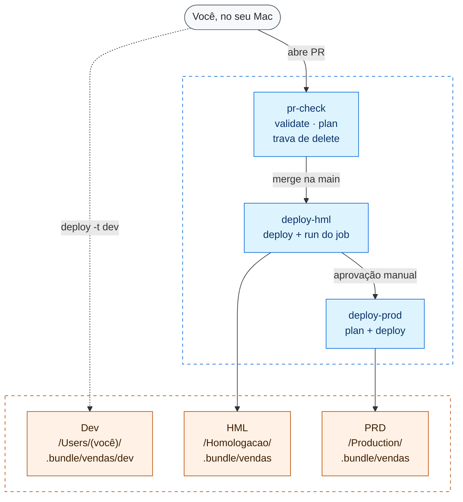

# dabs-cicd-lab

Laboratório de **Declarative Automation Bundles** (DABs, o antigo Databricks Asset Bundles) com CI/CD no GitHub Actions. São três ambientes, Dev, HML e PRD, montados num único workspace da **Databricks Free Edition**.

A ideia é mostrar, funcionando, o modelo que queremos para um time grande:

- Em **Dev**, cada pessoa publica na própria pasta.
- Em **HML e PRD**, só o pipeline publica, com service principals.

Nada aqui depende de uma pessoa específica.

> Tudo o que está descrito foi executado de verdade, com CLI **v1.21.0**, em outubro de 2026. O passo a passo completo, com os erros que apareceram no caminho, está em [`docs/lab-passo-a-passo.md`](docs/lab-passo-a-passo.md).

---

## Sumário

- [Visão geral](#visão-geral)
- [Os três ambientes](#os-três-ambientes)
- [Estrutura do repositório](#estrutura-do-repositório)
- [Fluxo de trabalho no dia a dia](#fluxo-de-trabalho-no-dia-a-dia)
- [O pipeline do GitHub Actions](#o-pipeline-do-github-actions)
- [Proteções que o lab comprovou](#proteções-que-o-lab-comprovou)
- [O que o bundle não cria (fundação)](#o-que-o-bundle-não-cria-fundação)
- [Limitações do laboratório](#limitações-do-laboratório)
- [Documentação](#documentação)
- [Fontes oficiais](#fontes-oficiais)
- [Autor](#autor)

---

## Visão geral



Em azul, os jobs do GitHub Actions. Em laranja, as pastas do bundle no workspace do Databricks, que no lab é um só. A linha pontilhada é o único deploy feito por uma pessoa.

O bundle `vendas` tem dois recursos:

| Recurso | Arquivo | O que faz |
|---|---|---|
| Job `sample_job` | `bundles/vendas/resources/sample_job.job.yml` | Roda o notebook `src/sample_notebook.ipynb`, que grava 100 linhas de `samples.nyctaxi.trips` em `trips_amostra` no schema do ambiente |
| Schema `vendas` | `bundles/vendas/resources/vendas.schema.yml` | Cria o schema no catálogo do ambiente. Em HML e PRD, também define quem pode gravar nele |

---

## Os três ambientes

Os três targets estão em [`bundles/vendas/databricks.yml`](bundles/vendas/databricks.yml).

| | **dev** | **hml** | **prod** |
|---|---|---|---|
| `mode` | `development` | `production` | `production` |
| Pasta no workspace | `/Workspace/Users/<você>/.bundle/vendas/dev` | `/Workspace/Homologacao/.bundle/vendas` | `/Workspace/Production/.bundle/vendas` |
| Nome do job | `[dev <você>] sample_job` | `[hml] sample_job` | `[prd] sample_job` |
| Tabela gravada | `dev.dev_<você>_vendas.trips_amostra` | `hml.hml_vendas.trips_amostra` | `prod.prd_vendas.trips_amostra` |
| Quem publica | você, pela CLI | `sp-lab-deploy`, pelo CI | `sp-prd-deploy`, pelo CI, depois da aprovação |
| Quem executa o job | você | `sp-hml-run` | `sp-prd-run` |
| Quando o job roda | quando você manda (`bundle run`) | o CI roda depois de cada deploy | agendamento pausado no lab; roda só com "Run now" |
| Branch permitida | qualquer uma | qualquer uma (o CI só publica a partir da `main`) | só `main` (`git.branch` no bundle e regra no environment) |

Por que HML e PRD dividem o mesmo workspace sem se misturar:

- **Pasta:** cada ambiente tem o seu `root_path`.
- **Catálogo:** `hml` e `prod` são catálogos separados.
- **Nome:** o `presets.name_prefix` coloca `[hml]` e `[prd]` no nome dos recursos.
- **Identidade:** cada ambiente tem os seus próprios service principals.

É o mesmo desenho do time: hoje HML divide o workspace com PRD, separado exatamente dessas quatro formas. Quando houver um terceiro workspace, só o `host` do target `hml` muda.

---

## Estrutura do repositório

```
.
├── .github/workflows/vendas.yml     # pr-check, deploy-hml, deploy-prod
├── bundles/
│   └── vendas/
│       ├── databricks.yml           # bundle, variáveis e os 3 targets
│       ├── resources/
│       │   ├── sample_job.job.yml   # job com 1 task de notebook (serverless)
│       │   └── vendas.schema.yml    # schema gerenciado pelo bundle
│       └── src/
│           └── sample_notebook.ipynb
├── docs/
│   ├── lab-passo-a-passo.md         # tudo o que foi feito no GitHub e no Databricks
│   ├── fundacao.md                  # o que existe fora do bundle e como recriar
│   └── roteiro-demo.md              # roteiro para apresentar ao time
└── README.md
```

Um repositório pode ter vários bundles em `bundles/<nome>/`. Cada bundle tem o seu workflow, filtrado pela pasta (`paths`) no evento de `push`.

---

## Fluxo de trabalho no dia a dia

**1. Crie uma branch e publique em Dev.** É o único ambiente em que você publica.

```bash
git switch main
git pull
git switch -c feat/minha-mudanca

cd bundles/vendas
databricks bundle validate -t dev
databricks bundle deploy -t dev
databricks bundle run -t dev sample_job
```

**2. Abra o PR.** O `pr-check` roda sozinho e mostra o `plan` de HML. Leia o plan antes de pedir revisão:

| Linha no plan | O que conferir |
|---|---|
| `create` | recurso novo: o nome e o ambiente estão certos? |
| `update` | algo que já existe vai mudar; se você não mexeu nele, alguém mexeu na UI (drift) |
| `delete` / `recreate` | **o check falha de propósito**. Se a remoção for intencional, coloque o label `permite-delete` no PR |

O `plan` mostra **recursos** (job, schema, grants), não código. Mudança de notebook se revisa na aba *Files changed*.

**3. Faça o merge.** O `deploy-hml` publica em HML e roda o job como `sp-hml-run`.

**4. Aprove o PRD.** O run fica em "Waiting" até alguém aprovar o environment `prod`. O `deploy-prod` mostra o `plan` de prod e publica.

Não rode `deploy -t hml` nem `deploy -t prod` no seu computador. O bundle bloqueia prod fora da `main`, mas a regra do time vale também para HML.

---

## O pipeline do GitHub Actions

Arquivo: [`.github/workflows/vendas.yml`](.github/workflows/vendas.yml).

| Job | Quando | Environment | O que faz |
|---|---|---|---|
| `pr-check` | todo PR para `main`, inclusive quando um label é colocado ou retirado | `hml` | `validate`, `plan -t hml` e a trava de delete/recreate |
| `deploy-hml` | `push` na `main` que mexe em `bundles/vendas/**` ou no workflow | `hml` | `deploy -t hml --auto-approve` e `run -t hml sample_job` |
| `deploy-prod` | depois do `deploy-hml`, com aprovação | `prod` | `plan -t prod` e `deploy -t prod --fail-on-active-runs` |

Detalhes que importam:

- **Autenticação:** OAuth M2M com o secret do SP de deploy de cada environment (`DATABRICKS_HOST` e `DATABRICKS_CLIENT_ID` como *variables*, `DATABRICKS_CLIENT_SECRET` como *secret*). Os nomes são os mesmos nos dois environments; o valor muda.
- **Actions fixadas por SHA:** `actions/checkout` v7.0.1 e `databricks/setup-cli` v1.21.0, com o CLI fixado em `1.21.0`.
- **`persist-credentials: false`:** o token do GitHub não fica salvo no runner, porque o workflow nunca faz push.
- **`concurrency` por ambiente** (`vendas-hml`, `vendas-prod`): dois deploys do mesmo ambiente nunca rodam juntos.
- **`deploy-prod` sem `--auto-approve`:** se o plano apagar ou recriar um recurso que guarda dados (schema, pipeline, volume…), o deploy falha em vez de seguir. **Jobs não estão nessa lista**, por isso existe a trava no `pr-check`.
- **Sem `paths` no `pull_request`:** o `pr-check` é obrigatório no ruleset. Com filtro de pasta, um PR que não mexe no bundle ficaria preso esperando o check.

---

## Proteções que o lab comprovou

Cada linha foi testada no passo 15 do lab. Os detalhes estão em [`docs/lab-passo-a-passo.md`](docs/lab-passo-a-passo.md#passo-15-testes-de-proteção).

| Risco | O que segura | Onde |
|---|---|---|
| Push direto na `main` | Ruleset: PR obrigatório e `pr-check` verde, sem bypass | GitHub |
| Alguém edita um job de HML/PRD na UI | O CLI publica os jobs com `edit_mode: UI_LOCKED`; o `plan` do PR mostra o drift; o próximo deploy desfaz | Databricks + CI |
| Um PR apaga um job sem ninguém perceber | Trava no `pr-check`: falha em `delete`/`recreate` sem o label `permite-delete` | CI |
| Deploy de prod a partir de outra branch | `git.branch: main` no target `prod` (CLI) e environment `prod` restrito à `main` (GitHub) | Bundle + GitHub |
| Dois merges seguidos | `concurrency`: o segundo deploy espera o primeiro | CI |
| Deploy em prod sem revisão | Environment `prod` com required reviewer | GitHub |
| Deploy em prod derrubando um job em execução | `--fail-on-active-runs` | CLI |
| Permissão de escrita dada "na mão" e esquecida | `grants` do schema versionados no bundle (no lab, redundantes com os grants do catálogo; ver `docs/fundacao.md`) | Bundle |

Três comportamentos que surpreenderam e valem para o time:

1. **`bundle validate` não é só leitura.** Na primeira vez, ele cria a pasta `files` do `root_path` com a identidade de quem rodou. Por isso `validate` e `plan` de HML e PRD rodam só no CI.
2. **Uma aprovação de prod esquecida trava a fila.** O job que espera aprovação já ocupa o grupo de `concurrency`. O pedido de aprovação do próximo deploy só aparece quando o anterior termina.
3. **Os `grants` do bundle mandam na lista inteira do schema.** Um `GRANT` manual nesse schema é removido no próximo deploy. Leitura para pessoas vai no catálogo, fora do bundle.

---

## O que o bundle não cria (fundação)

`bundle destroy` e `bundle deploy` cuidam só da **carga de trabalho**: job, schema, grants do schema e arquivos. O resto foi feito à mão e não volta sozinho:

- catálogos `dev`, `hml` e `prod`, e os grants neles (dos SPs e de leitura para pessoas);
- os 4 service principals, o entitlement `workspace-access`, a permissão *Use* entre eles e os secrets OAuth;
- environments, variables, secrets, reviewer e regra de branch no GitHub;
- o ruleset da `main` e o label `permite-delete`.

O checklist completo, com os comandos para recriar, está em [`docs/fundacao.md`](docs/fundacao.md).

Ao recriar com `destroy` e `deploy`, três coisas não voltam iguais:

- o job volta com **ID novo e sem histórico** de execuções;
- o schema volta **vazio**, e os dados só reaparecem quando o job roda de novo;
- o que foi feito à mão e não está no YAML se perde.

---

## Limitações do laboratório

| No lab | No time real |
|---|---|
| Um workspace para tudo (Free Edition) | Dev num workspace; HML e PRD no outro, separados como aqui; depois, um terceiro workspace para HML |
| Secret OAuth M2M guardado nos environments do GitHub, porque a Free Edition não tem console de conta para criar federation policy | OIDC (workload identity federation), sem secret guardado |
| Repositório público, porque no GitHub Free os required reviewers e as regras de environment só valem em repositório público | Repositório privado na organização |
| Agendamento pausado em PRD (`trigger_pause_status: PAUSED`) | Agendamento ativo em PRD, com cron e fuso definidos |
| Grants de leitura para um e-mail | Grants para grupos de conta |
| Um único revisor, sem aprovação obrigatória no PR | Aprovação de PR obrigatória e `CODEOWNERS` por pasta |

---

## Documentação

| Documento | Para quem | Conteúdo |
|---|---|---|
| [`docs/lab-passo-a-passo.md`](docs/lab-passo-a-passo.md) | quem vai montar ou entender o lab | todos os passos, do zero ao teste de destroy, com erros e correções |
| [`docs/fundacao.md`](docs/fundacao.md) | plataforma | tudo o que fica fora do bundle, com comandos e verificação |
| [`docs/roteiro-demo.md`](docs/roteiro-demo.md) | quem vai apresentar | demo ao vivo de 20 a 25 minutos, com o que falar em cada etapa |

---

## Fontes oficiais

**Databricks**

- [Bundles: deployment modes](https://docs.databricks.com/aws/en/dev-tools/bundles/deployment-modes)
- [Bundles: run_as](https://docs.databricks.com/aws/en/dev-tools/bundles/run-as)
- [Bundles: permissões](https://docs.databricks.com/aws/en/dev-tools/bundles/permissions)
- [Bundles: direct engine](https://docs.databricks.com/aws/en/dev-tools/bundles/direct)
- [Comandos `databricks bundle`](https://docs.databricks.com/aws/en/dev-tools/cli/bundle-commands)
- [Autenticação de bundles](https://docs.databricks.com/aws/en/dev-tools/bundles/authentication)
- [CI/CD com GitHub Actions](https://docs.databricks.com/aws/en/dev-tools/ci-cd/github)
- [OIDC com GitHub Actions](https://docs.databricks.com/aws/en/dev-tools/auth/provider-github)
- [Agendamento de jobs](https://docs.databricks.com/aws/en/jobs/scheduled)
- [Releases do CLI](https://github.com/databricks/cli/releases) e [databricks/setup-cli](https://github.com/databricks/setup-cli)

**GitHub**

- [Environments e deployment branches](https://docs.github.com/en/actions/reference/workflows-and-actions/deployments-and-environments)
- [Rulesets](https://docs.github.com/en/repositories/configuring-branches-and-merges-in-your-repository/managing-rulesets/creating-rulesets-for-a-repository)
- [Required status checks: troubleshooting](https://docs.github.com/en/pull-requests/how-tos/merge-and-close-pull-requests/troubleshooting-required-status-checks)
- [Concurrency](https://docs.github.com/en/actions/concepts/workflows-and-actions/concurrency) e [como configurar](https://docs.github.com/en/actions/how-tos/write-workflows/choose-when-workflows-run/control-workflow-concurrency)
- [Uso seguro do Actions (fixar por SHA)](https://docs.github.com/en/actions/reference/security/secure-use)
- [CODEOWNERS](https://docs.github.com/en/repositories/managing-your-repositorys-settings-and-features/customizing-your-repository/about-code-owners)

**Código-fonte do CLI (v1.21.0)**, consultado para os comportamentos que a documentação não detalha:

- [`validate` cria a pasta `files`](https://github.com/databricks/cli/blob/v1.21.0/libs/sync/path.go)
- [quais recursos pedem confirmação no deploy](https://github.com/databricks/cli/blob/v1.21.0/bundle/phases/deploy.go)
- [checagem de `git.branch`](https://github.com/databricks/cli/blob/v1.21.0/bundle/config/mutator/validate_git_details.go)
- [jobs publicados com `UI_LOCKED`](https://github.com/databricks/cli/blob/v1.21.0/bundle/deploy/metadata/annotate_jobs.go)
- [grants do bundle substituem a lista do schema](https://github.com/databricks/cli/blob/v1.21.0/bundle/direct/dresources/grants.go)

---

## Autor

**Thomaz Antonio Rossito Neto** é Principal Data Architect & AI Strategy na CI&T, no Databricks & Microsoft Fabric Partner CoE. Tem mais de 8 anos em engenharia e arquitetura de dados e 10 certificações (Databricks 5, Azure 4 e AWS 1). Atua na América Latina e na América do Norte, em ambientes multi-cloud (Azure e AWS) com Databricks e Microsoft Fabric.

Criou o [Data Agents](https://github.com/ThomazRossito/data-agents), framework open-source de orquestração multi-agente para dados corporativos, e o [SifTools](https://github.com/ThomazRossito/siftools), de engenharia de contexto para agentes com MCP. Conduz workshops e treinamentos técnicos para times da CI&T e clientes.

- LinkedIn: [linkedin.com/in/thomaz-antonio-rossito-neto](https://www.linkedin.com/in/thomaz-antonio-rossito-neto/)
- GitHub: [github.com/ThomazRossito](https://github.com/ThomazRossito)
- Medium: [medium.com/@thomazrossito](https://medium.com/@thomazrossito)
- YouTube: [youtube.com/@thomazantoniorossitoneto4541](https://www.youtube.com/@thomazantoniorossitoneto4541)
